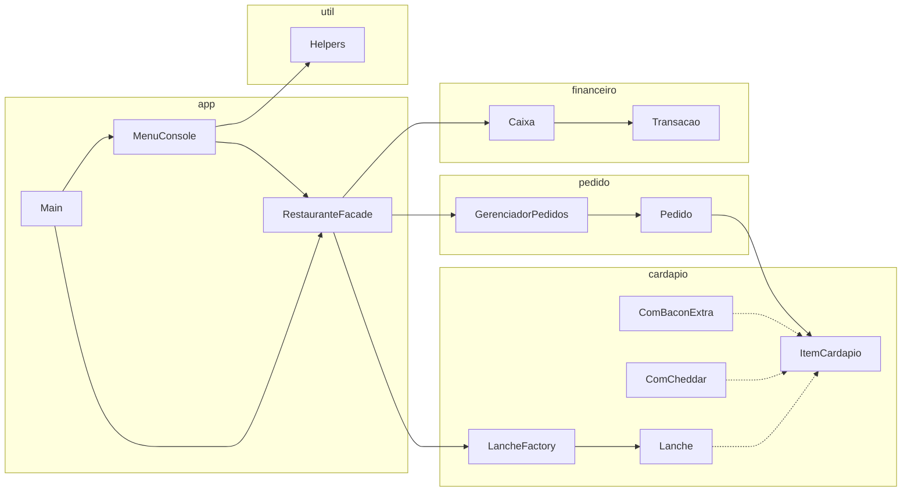

# Sistema de Restaurante

Sistema de console para um restaurante, feito no Projeto 1. Ele registra pedidos, deixa personalizar os lanches com adicionais ou sem ingredientes, modifica e cancela pedidos e faz o fechamento do dia.

Vídeo: [assista aqui]([(https://youtu.be/1iXjlYX6tsM)])

## Como rodar

Precisa do Java 21. Na IDE, rode a classe `app.Main`. No terminal:

```bash
mvn package
java -jar target/SistemaRestaurante-1.0-SNAPSHOT.jar
```

O `mvn package` roda os testes antes de gerar o jar. Para rodar só os testes, use `mvn test`.

## Visão geral



O `Main` só controla o fluxo e não imprime nada. O `MenuConsole` conversa com a pessoa, lendo as opções e mostrando os resultados. A `RestauranteFacade` coordena as operações sem saber nada de console. As classes de `cardapio`, `pedido` e `financeiro` guardam os dados e fazem as contas.

## Pacotes

- `app`: `Main`, `MenuConsole` e `RestauranteFacade`.
- `cardapio`: a interface `ItemCardapio`, o `Lanche`, a `LancheFactory` e os adicionais.
- `pedido`: o `Pedido`, que cuida de uma comanda, e o `GerenciadorPedidos`, que guarda todos os pedidos do dia num `HashMap`.
- `financeiro`: `Caixa` e `Transacao`.
- `util`: leitura de número e de texto que avisa e pergunta de novo quando a entrada é inválida.

## Padrões de projeto

A `RestauranteFacade` é uma Facade: o menu passa por ela para criar pedidos, montar lanches e fechar o dia, sem conhecer as classes de dentro.

A `LancheFactory` cria um lanche novo a cada chamada. Por isso, tirar a cebola do X-Bacon de um pedido não muda o X-Bacon de outro.

Os adicionais usam Decorator. `ComCheddar` e `ComBaconExtra` embrulham outro `ItemCardapio` e somam descrição e preço, então `new ComBaconExtra(new ComCheddar(LancheFactory.xBacon()))` vira "X-Bacon + cheddar + bacon extra" por R$ 32,00.

O `Caixa` é Singleton. O construtor é privado e todo mundo usa `Caixa.getInstancia()`, então a própria classe garante que só existe um caixa.

## O que foi feito

Os três níveis do enunciado e cinco bônus: gorjetas no fechamento, o `Caixa` com um `HashSet<Transacao>` (a `Transacao` compara pelo número do pedido), três testes a mais, o jar executável e a contagem de lanches base no fechamento.

Os testes cobrem preço negativo, preço com adicionais, combinações repetidas, total do dia e cancelamento de pedido.

## Ordem dos adicionais

"X-Bacon + cheddar + bacon extra" e "X-Bacon + bacon extra + cheddar" são o mesmo lanche, mas o `HashSet` compara texto e contaria duas combinações. No fechamento, os adicionais são ordenados antes de entrar no `HashSet`, e as duas viram uma só. A solução depende do separador " + " na descrição; se um adicional tivesse "+" no nome, ela quebraria.
